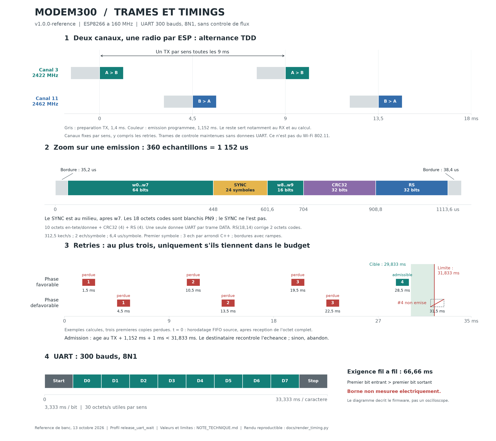

# Modem300 : note technique de reference

Version `v1.0.0-reference` du 13 octobre 2026. Firmware `release_uart_wait`, Arduino ESP8266 core 3.1.2, CPU 160 MHz. **Documentation d'un firmware existant et teste, sans modification de son comportement.**



## 1. Contrat du modem

Le modem transporte un flux d'octets sur un UART **nominal 300 bauds, 8 bits, aucune parite, un bit de stop**, sans RTS/CTS ni XON/XOFF. Les octets 0x00, 0x11, 0x13, 0xC0, 0xDB et toutes les autres valeurs sont des donnees ordinaires pour le firmware.

- Un bit UART dure nominalement **3,333 ms**.
- Un caractere 8N1 comprend 10 bits et dure **33,333 ms**.
- Le debit utile continu est donc **30 octets/s**, soit 240 bits utiles/s par sens.
- La liaison peut transporter les deux flux UART en meme temps, meme si la radio alterne les sens.
- Le firmware travaille sur des octets complets : il attend leur reception UART, pas seulement leur premier bit.

Le contrat privilegie la latence : si un octet ne peut plus sortir dans son budget, il est abandonne. Le FEC corrige les erreurs corrigeables ; le CRC rejette les candidats invalides. Cela ne constitue pas une garantie mathematique de zero erreur avec un code fini. BREAK, 7E1, 8N2, commandes AT et lignes de controle d'un modem telephonique ne sont pas emules.

## 2. Pourquoi deux canaux ?

**Oui, cette version utilise deux frequences centrales, fixes par sens.**

| Equipement | Reception habituelle | Emission |
|---|---|---|
| A, initiateur temporel | Canal 11, 2462 MHz | Canal 3, 2422 MHz, vers B |
| B, asservi au rythme de A | Canal 3, 2422 MHz | Canal 11, 2462 MHz, vers A |

Chaque ESP commute son unique chemin radio entre ces reglages. Il n'emet pas et ne recoit pas simultanement. Les numeros de canal servent ici au reglage RF du composant : **les trames utiles sont une FSK personnalisee, pas des paquets Wi-Fi 802.11 ni un flux IP**.

Ce choix est empirique, issu de l'asymetrie observee sur le banc entre les recepteurs. Il ne prouve pas que ces canaux sont universellement meilleurs, ni qu'ils rendent la liaison immune aux brouilleurs. Les anciens essais sur canal commun sont conserves dans `mesures/`. Un retry A vers B reste sur le canal 3 ; il n'y a pas de saut de frequence par retransmission.

Les deux tons sont nominalement a **-78,125 kHz et +78,125 kHz** de la frequence centrale choisie. Les erreurs d'oscillateur et le comportement analogique reel ne sont pas une mesure de frequence absolue : la reception les compense numeriquement.

## 3. Organisation temporelle radio

| Parametre | Valeur de la reference |
|---|---:|
| Echantillonnage | 312 500 echantillons/s |
| Periode d'echantillon | 3,2 us |
| Echantillons par symbole | 2 |
| Periode nominale du symbole FSK | 6,4 us |
| Debit FSK instantane, hors bordures | 156 250 symboles/s, un bit/symbole |
| Taille du programme d'emission | 360 echantillons |
| Fenetre d'emission programmee | 1 152 us |
| Intervalle entre les sens | 4 500 us |
| Cycle A/B | 9 000 us |
| Anticipation de preparation TX | 1 400 us |
| Debut de capture avant le TX attendu | 150 us |
| Capture verrouillee | 486 echantillons, soit 1 555,2 us |
| Capture de recherche | 1 024 echantillons, soit 3 276,8 us |
| Accumulation materielle IQ | 64 |

En regime verrouille, avec une origine arbitraire sur un TX de A :

| Instant nominal | Emetteur | Recepteur | Canal | Fin de la fenetre TX |
|---:|---|---|---:|---:|
| 0 ms | A | B | 3 | 1,152 ms |
| 4,5 ms | B | A | 11 | 5,652 ms |
| 9 ms | A | B | 3 | 10,152 ms |
| 13,5 ms | B | A | 11 | 14,652 ms |

Les intervalles sans emission servent au changement de canal, au retour RX, a la capture et au decodage. Ils ne sont pas tous du temps CPU libre. B recale son origine temporelle sur les trames valides de A ; il repart en recherche apres 12 receptions consecutives non acceptees.

La radio envoie aussi des trames de controle sans octet utilisateur. Le rythme RF peut donc subsister quand le port serie est inactif : il entretient synchronisation, ACK et calibration. Un silence ou un trait dans une cascade SDR ne suffit pas a identifier une perte.

La capacite maximale theorique avant retries est **111,11 octets/s par sens** : un octet par cycle de 9 ms. Elle depasse les 30 octets/s UART pour laisser du temps aux reprises. Ce debit utile potentiel est distinct du debit FSK instantane, beaucoup plus eleve pour raccourcir les rafales.

## 4. Format de la trame

### Bloc logique de 18 octets

Le bloc contient **10 octets d'en-tete/donnee, 4 octets CRC32 et 4 octets de parite RS**. Une trame DATA transporte exactement un octet UART ; une trame CTRL n'en transporte aucun. Le champ ACK peut accompagner les deux types.

| Octet(s) | Fonction dans le profil natif |
|---|---|
| `w0` | Identifiant/role : 0xAC pour A, 0xAD pour B |
| `w1` | Drapeaux : bit 0 DATA, bit 1 ACK valide |
| `w2` | Sequence de l'octet emis, sur 8 bits |
| `w3` | Sequence acquittee dans l'autre sens |
| `w4`, `w9` | Session de demarrage emetteur, 16 bits, bas puis haut |
| `w5` | Octet utilisateur si DATA ; octet bas de la session acquittee si CTRL |
| `w6` | Cadence UART : entier signe, `(periode_us - 33333) / 4` |
| `w7` | Marqueur du profil natif : 0x7E |
| `w8` | Age DATA en pas de 125 us ; octet haut de la session acquittee si CTRL |
| `w10..w13` | CRC32 des dix premiers octets, little-endian |
| `w14..w17` | Parite Reed-Solomon des quatorze premiers octets |

Le CRC32 utilise le polynome reflechi `0xEDB88320`, l'etat initial `0xFFFFFFFF` et le complement final. Le RS raccourci est **RS(18,14), GF(256), polynome 0x11D**, avec quatre octets de parite et correction de deux octets codes. Sa protection inclut donc aussi le CRC et l'en-tete, pas uniquement l'octet utilisateur.

Apres encodage, les 18 octets sont blanchis par PN9 : registre initialise a `0x1FF`, XOR de sortie bit 0, retour `(bit0 XOR bit5)` vers le bit 8 lors du decalage a droite. Le masque est applique bit 0 a bit 7 de chaque octet ; les octets ainsi obtenus sont ensuite emis **bit de poids fort en premier**. Le motif de synchronisation n'est pas blanchi.

### Ordre reel des symboles

La synchronisation n'est **pas un preambule en tete** : ses 24 symboles sont inseres **apres les 64 premiers bits codes**, donc entre `w7` et `w8`.

```text
bordure | w0..w7 | SYNC 24 symboles | w8..w9 | CRC32 | RS | bordure
```

Le programme TX fait `(144 bits codes + 24 symboles SYNC + 12 equivalents-symboles de bordure) x 2 = 360 echantillons`. Le schema represente les indices exacts de la version figee :

| Partie | Indices d'echantillons inclus | Duree | Debut / fin, en us |
|---|---|---:|---:|
| Bordure initiale | 0..10 | 35,2 us | 0 / 35,2 |
| `w0..w7`, 64 bits codes | 11..139 | 412,8 us | 35,2 / 448 |
| SYNC, 24 symboles | 140..187 | 153,6 us | 448 / 601,6 |
| `w8..w9`, 16 bits codes | 188..219 | 102,4 us | 601,6 / 704 |
| CRC32, 32 bits codes | 220..283 | 204,8 us | 704 / 908,8 |
| RS, 32 bits codes | 284..347 | 204,8 us | 908,8 / 1113,6 |
| Bordure finale | 348..359 | 38,4 us | 1113,6 / 1152 |

Detail d'implementation preserve : la division entiere C++ de `(n - 12) / 2` tronque vers zero. Le premier symbole occupe donc trois echantillons, et les suivants deux. D'ou 412,8 us pour les 64 premiers bits au lieu de 409,6 us. La duree totale reste 1 152 us. Les bordures contiennent les rampes et la commande d'amplitude ; ce tableau n'est ni une capture RF ni une garantie de bande occupee ou de temps de commutation analogique.

## 5. Reception et calibration continue

La capture IQ est traitee sur l'ESP : retrait de la composante continue, discrimination de phase/frequence, filtrage, recherche du motif SYNC et estimation du decalage de frequence ainsi que de l'ecartement des tons. Jusqu'a trois hypotheses de synchronisation sont examinees. Le flux est deblanchi, repare par RS, puis soumis aux controles d'en-tete, CRC32 et metadonnees.

La derniere estimation de porteuse validee par CRC est conservee pour le traitement suivant. **Les deux recepteurs calibrent en continu**, y compris grace aux trames de controle. Les tons d'emission natifs restent fixes : il s'agit d'une compensation numerique RX, pas d'une boucle qui ajuste continuellement l'oscillateur TX.

Le profil utilise les codes de gain RF 0 et BB 0, sans les presenter comme des dB mesures. Auto-connexion et reconnexion Wi-Fi sont desactivees. L'experience de suppression du timer de bruit SDK n'est pas active dans cette reference.

## 6. ARQ : maximum de trois retries

Le protocole conserve un octet en attente par sens, sa sequence et son horodatage d'origine. Les repetitions gardent cet horodatage ; elles ne recommencent jamais le budget de latence. Le destinataire elimine les doublons et renvoie un ACK dans une trame du sens oppose. Un echange de sessions est necessaire avant d'envoyer des donnees.

Le maximum est **quatre tentatives RF, initiale comprise**. Une tentative radio interrompue compte aussi. La preparation seule n'est pas comptee comme une emission.

Condition d'admission d'une tentative dans le code :

```text
nombre_de_tentatives < 4
ET age_au_debut_TX + 1152 us + 1000 us < 31833 us
```

Les 1 000 us sont une reserve d'admission du traitement, pas une preuve du pire temps de calcul possible. Le recepteur effectue encore son controle d'echeance avant sortie.

Avec des reprises espacees de 9 ms, la quatrieme tentative ne tient que pour certaines phases d'arrivee. Exemple admissible : TX a 1,5 / 10,5 / 19,5 / 28,5 ms apres l'horodatage FIFO. Exemple avec trois premieres copies perdues : TX a 4,5 / 13,5 / 22,5 ms ; une quatrieme a 31,5 ms est refusee car hors budget. **Trois retries maximum ne signifie pas trois retries garantis.**

Un ACK signifie que le recepteur a accepte et programme l'octet, pas que son dernier bit UART est deja sorti. Un abandon ulterieur de sortie reste possible. Inversement, une perte ou un retard d'ACK peut faire expirer le cote emetteur alors que l'octet a ete livre. Il ne faut donc pas assimiler le compteur `exp` au nombre exact d'octets manquants chez l'utilisateur.

## 7. Latence et UART

Deux references temporelles doivent etre distinguees : le premier bit sur le fil, et l'horodatage logiciel du FIFO apres reception d'un octet.

| Regle logicielle | Valeur |
|---|---:|
| Cible de debut de sortie, depuis le FIFO reconstruit | 29 833 us |
| Retard maximal accepte sur cette cible | 2 000 us |
| Limite absolue depuis ce FIFO reconstruit | 31 833 us |
| Quantum de codage de l'age | 125 us, arrondi vers le haut |
| Observation d'entree sans service toleree | Au plus 1 000 us |

Le destinataire reconstruit `cible = debut_RF_recu + 29833 - age_code * 125`. Une donnee trop tardive, une sortie occupee ou un FIFO non horodatable provoque un abandon. Le registre de decalage UART est pris en compte par une estimation temporelle ; la verification sur les fils reste necessaire.

La cadence du correspondant est estimee sur des groupes de huit intervalles UART et transmise dans `w6`. La sortie ajuste son diviseur entre caracteres avec 80 us de marge par caractere. Cela evite l'accumulation d'une file due a de petits ecarts d'horloge ; le port reste nominalement a 300 bauds.

Le service UART tourne via un timer nominal de 50 us et est aussi appele pendant les boucles RF, y compris l'attente avant emission avec interruptions masquees. Les echeances serie utilisent **`micros()`**, pas le compteur de cycles CPU. Les cycles CPU servent toujours a cadencer les echantillons RF.

**Exigence utilisateur : 66,66 ms maximum entre premier bit UART entrant et premier bit UART sortant. Cette borne n'a pas ete mesuree ni certifiee electriquement.** Les timestamps USB/VM ne suffisent pas. Il faut capturer les deux UART avec une horloge commune, y compris sous pertes et retries. Une latence jusqu'au dernier bit de sortie serait une autre grandeur, avec environ un caractere supplementaire.

## 8. Mesures et limites connues

| Dernier essai persistant | Envoyes | Recus identiques |
|---|---:|---:|
| A vers B | 3219 | 3219 |
| B vers A | 3216 | 3216 |
| Simultane A vers B | 3219 | 3219 |
| Simultane B vers A | 3216 | 3216 |
| Total | 12870 | 12870 |

Identite binaire et SHA-256, 512 trames applicatives exactes, aucune perte, modification, duplication ou inversion d'ordre sur cet essai. Les trames SLIP/CRC du **banc** sont des donnees utilisateur de test, pas un encadrement impose par le modem.

L'essai instrumente precedent du meme correctif a livre 12 869 octets sur 12 870. Il a mesure : aucune erreur, aucun debordement ni abandon UART ; intervalle maximal d'observation d'entree de 54 us ; retard logiciel maximal de sortie de 86 us sur A et 152 us sur B. **Ces 86/152 us ne sont pas la latence fil-a-fil.**

Les echecs radio observes comprennent la synchronisation, le FEC et quelques controles d'en-tete/CRC. Les compteurs par hypothese ne s'additionnent pas comme des paquets independants. Ni une comparaison de longueurs ni une sous-sequence ne mesure le BER RF. Les traces ne prouvent pas qu'un emetteur Wi-Fi, Bluetooth ou Zigbee particulier est responsable des rafales.

RAM statique : **39 108 / 80 192 octets**. Code IRAM : **30 911 / 32 768 octets**, plus 32 768 octets de cache d'instructions. Les files sont fixes ; celle d'entree a quatre emplacements, dont trois utilisables. La calibration reste active. La RAM des builds instrumentes est plus elevee que celle des binaires livres.

Non qualifies : plusieurs heures continues, plage de temperature, distance, sensibilite et puissance calibrees, brouilleurs controles, tous les cas de reset, compatibilite avec toutes les interfaces 300 bauds et conformite RF. Le bruit du boot ROM n'est pas supprime ; le banc attend six secondes au demarrage.

## 9. Reproductibilite

Les valeurs de cette note proviennent de `firmware/FastA/FastA.ino`, `firmware/FastB/FastB.ino`, `fast.h` et des fichiers JSON de `mesures/`. Les reperes principaux sont `Fast::encode/decode/scramble`, `Radio::prepare/transmitSamples/receive`, `UartRx`, `Release`, et `FastModem::outgoing/incoming/poll`.

`RELEASE.json` fixe le profil et les SHA-256 des sources et binaires. `docs/render_timing.py` verifie ces empreintes et les constantes du profil, recalcule les partitions d'echantillons et produit le PNG ainsi que `docs/timing_values.json`. Le manifeste identifie tous les fichiers du ZIP. Il fournit une verification d'integrite, pas une signature numerique d'un tiers.

Le depot original complet, le rapport historique, les traces brutes et les scripts de construction sont conserves. Voir [README.md](README.md) pour reconstruire sans flash et pour les precautions de ports USB/VirtualHere.
