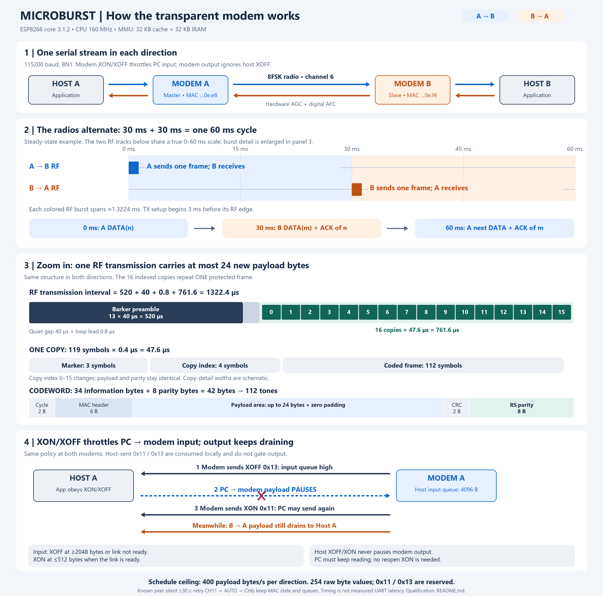

# MICROBURST Transparent Modem

MICROBURST connects two serial hosts through an ESP8266 radio link. Each host uses a **115200 baud, 8N1 serial port**. The modem sends **XON/XOFF to throttle PC → modem input**. **Modem → PC output keeps draining and ignores host-sent XOFF/XON.** The modems packetize, protect, acknowledge and retransmit the data internally.

**One standalone `Microburst.ino` runs on both boards.** The physical station MAC address selects the role automatically; no separate master/slave sketch or local header files are required.



## Quick start

1. Use the same [Microburst/Microburst.ino](Microburst/Microburst.ino) on both ESP8266 boards. Before compiling, select **LOLIN(WEMOS) D1 R2 & mini**, core **3.1.2**, CPU **160 MHz**, **4 MB flash with 1 MB filesystem**, and **Tools > MMU > 32KB cache + 32KB IRAM (balanced)**. Use `firmware/Microburst.ino.bin` only when the accompanying validation identifies it as the current revision.
2. Connect each board's serial port to its host. Set **115200 baud, 8 data bits, no parity, 1 stop bit**. Enable **software XON/XOFF**; disable RTS/CTS and DSR/DTR flow control. For bulk sending, use application-side flow handling with bounded queued writes as described below; native bulk flow lost data in both tested Linux and Windows CH340/VirtualHere chains. For a direct TTL UART, use 3.3 V levels, crossed TX/RX and a common ground.
3. Allow the boards to initialize, synchronize and establish their session. The modem requests XOFF while the link is unavailable and XON when it is ready to accept host data. The PC must respect these requests before sending more input.
4. Send data normally. No host XON is required to unlock received output after opening or reopening a terminal: host-sent XON/XOFF does not gate modem output. The modem has no AT command mode or application handshake. `AT`, `+++`, NUL and ordinary binary bytes remain data.

The ESP8266 boot ROM emits bytes at **74880 baud** during reset, before the application starts. At 115200 baud these can appear as garbage when a terminal or USB adapter causes a reset. Keep these startup bytes out of application payload. The application does not inject diagnostic text into the serial stream.

## Board roles

| Diagram name | Radio role | Physical station MAC |
|---|---|---|
| **Modem A — blue** | Master; establishes the session and timing reference | `68:c6:3a:d6:0e:e8` |
| **Modem B — orange** | Slave; synchronizes to the master | `b4:e6:2d:23:0e:f4` |

These assignments are unchanged. An unlisted MAC has no assigned role: radio operation stays off and host input stays stopped. Using different boards requires updating the role mapping and rebuilding.

## What “transparent” means

The modem forwards the **254 byte values other than `0x11` and `0x13` unchanged**, in order. Serial writes and reads need not preserve packet boundaries: a long host write is divided into radio payloads of up to 24 bytes, and a short write can use a partially filled payload.

| Local UART traffic | Meaning |
|---|---|
| Modem → PC: `0x11` / DC1 / XON | PC may resume supplying payload to this modem |
| Modem → PC: `0x13` / DC3 / XOFF | PC must pause supplying payload to this modem |
| PC → modem: raw `0x11` or `0x13` | Consumed locally; ignored for output gating; never forwarded as payload |
| All other values | Payload; forwarded verbatim |

This is **input-only software flow control**. The modem protects its host-input queue, while received radio payload continues toward the PC whenever the UART transmitter has room. A terminal or operating system may consume the modem's controls before the host application sees them.

The PC must keep reading incoming data: sending XOFF to the modem does not protect a stopped or overloaded PC receiver in this revision. The ESP does not detect a logical terminal close/reopen; output permission is simply not latched off by a host control byte.

If both applications need all 256 byte values, they can apply the historical V14 escaping convention at the two hosts:

| Original payload byte | Bytes sent through the modem |
|---|---|
| `11` | `7D 31` |
| `13` | `7D 33` |
| `7D` | `7D 5D` |

Other bytes stay unchanged. Encode before sending and decode after receiving, at both ends. This is an optional host convention; **the firmware does not escape or unescape payload**. Historical tests below used raw payload with this codec disabled.

## Radio timing

The link uses **time division duplex (TDD)** on channel 6. Both hosts can exchange streams concurrently, while the radios alternate their transmission opportunities.

| Parameter | Current profile |
|---|---|
| Complete TDD cycle | **60 ms** |
| Half-slot | **30 ms** |
| Transmission opportunities | One per modem per 60 ms |
| Maximum new payload per DATA frame | **24 bytes** |
| Modulation | **8FSK**, 3 coded bits per symbol |
| Symbol duration | **0.4 µs**: 64 CPU cycles at 160 MHz |
| Copies within one transmission | **16 indexed copies of the same codeword** |
| TX preparation lead | **3 ms before** the scheduled RF edge |
| Configured guard budget | **1 ms**; not a transmitted frame field |
| Gain / frequency tracking | **Hardware AGC enabled; digital AFC enabled** |
| Required MMU allocation | **32 KB instruction cache + 32 KB IRAM (balanced)** |

A steady-state example, with the first master RF edge chosen as `t = 0`:

- **0 ms — A → B:** A sends DATA `n` and any acknowledgement for earlier B traffic.
- **30 ms — B → A:** B can send its own DATA `m` with a piggyback acknowledgement for A's DATA.
- **60 ms — A → B:** A can send the next DATA and acknowledge B's DATA.

If there is no eligible local DATA, the modem can use a dedicated ACK. JOIN/JOIN-ACK establish the session, and SYNC maintains timing when needed. Control traffic, retries or unavailable data can occupy or leave unused a transmission opportunity.

The **30 ms half-slot is not 30 ms of continuous RF transmission**. The configured preamble-to-train-end interval is approximately **1.3224 ms**. The rest of the schedule allows receive processing, UART service, radio restoration and preparation for later events. Preparation is started before the RF edge; it is not an extra on-air field.

The slave acquires validated master timing anchors and disciplines its timer from subsequent master frames. It suppresses transmission when timing confidence expires, then listens and reacquires rather than transmitting against an untrusted clock. An isolated corrupt packet does not immediately discard synchronization.

After a validated peer has been observed, this revision repeats the channel 11 → hardware AUTO → channel 6 calibration sequence when no valid peer frame arrives for **30 seconds**. The check runs between receive/transmit operations and acquisition windows, so it is a processing threshold rather than an exact electrical deadline. It preserves the MAC session, pending DATA, duplicate history and accepted UART queues. Each retry receives a fresh 30-second grace period. Initial search before any peer has been observed is unchanged. This recovery mechanism does not establish why PHY reception originally stopped, or guarantee recovery on a permanently unusable channel.

## Inside one RF transmission

The diagram expands three different scales: the 60 ms schedule, one RF transmission, and the bytes protected inside one copy.

```text
520 µs Barker preamble
  + 40 µs quiet gap
  + 0.8 µs symbol-loop lead
  + 16 × 47.6 µs indexed copies
  = 1322.4 µs configured transmission interval
```

The preamble contains 13 chips of 40 µs. Each indexed copy contains:

| Part | Symbols | Duration |
|---|---:|---:|
| Marker | 3 | 1.2 µs |
| Encoded copy index, 0–15 | 4 | 1.6 µs |
| Reed–Solomon coded frame | 112 | 44.8 µs |
| **One copy** | **119** | **47.6 µs** |
| **16-copy train** | **1904** | **761.6 µs** |

The copy index changes; the protected payload and parity remain the same. **Sixteen copies carry one DATA frame, not sixteen independent 24-byte payloads.**

### Protected frame layout

The fixed envelope is **34 information bytes**. Eight Reed–Solomon parity bytes make a **42-byte codeword**, mapped to 112 8FSK symbols without padding bits.

| Envelope byte offset | Size | Field |
|---|---:|---|
| 0–1 | 2 bytes | TDD cycle counter |
| 2 | 1 byte | Version in high nibble; frame type in low nibble |
| 3–4 | 2 bytes | Session |
| 5 | 1 byte | Sequence |
| 6 | 1 byte | ACK |
| 7 | 1 byte | Actual payload length, 0–24 |
| 8–31 | 24 bytes | Payload area; unused bytes are zero |
| 32–33 | 2 bytes | CRC16 over bytes 0–31 |
| After envelope | 8 bytes | Reed–Solomon parity |

Multibyte fields use big-endian order. Frame types are JOIN, JOIN-ACK, DATA, ACK and SYNC. Only DATA carries application payload. CRC16-CCITT uses polynomial `0x1021`, initial value `0xFFFF`, no reflection and no final XOR. The actual transmitted envelope has one CRC; the internal codec representation is reconstructed after that CRC is checked.

Reed–Solomon can correct byte errors and erasures within `2 × errors + erasures ≤ 8`. CRC, session, sequence and timing checks still decide whether a decoded frame is accepted.

## Acknowledgements, retries and backpressure

Each direction has one pending DATA frame at a time. The sender retains it until a valid acknowledgement arrives. DATA can piggyback the next expected receive sequence; a dedicated ACK identifies the received DATA sequence. Repeated DATA is acknowledged without delivering its payload twice.

A retry uses the next eligible local TX slot. The internal `retry_us = 1` setting makes a frame immediately eligible; it does not create a 1 µs radio retry interval. After 32 attempts, continuous serial operation waits one second before renewing the attempt budget, retaining the pending payload.

Each modem has a **4096-byte host-input queue** and a **1024-byte host-output queue**. Input flow thresholds include bytes still waiting in the UART driver:

- Request **XOFF** when input occupancy plus UART backlog reaches **2048 bytes**, or when the radio link is not ready.
- Request **XON** when the link is ready and occupancy falls to **512 bytes or less**.
- Refresh the requested flow state every **500 ms**. If the host continues sending while stopped, repeat XOFF after **20 ms**.

Host-sent `0x13` no longer creates an output-pause state. `0x11` is also consumed without changing output permission. A queued radio payload is written toward the PC as UART service and TX FIFO capacity permit; an explicit host XON is not needed to resume it. The modem's own XON/XOFF requests still have priority over payload writes.

The 1024-byte output queue remains an internal capacity limit. If it cannot accept a radio DATA payload, that DATA is refused before delivery is committed or acknowledged, so its sender retains it for retry. This is separate from host flow control: a host XOFF does not deliberately hold this queue full.

For bulk input, the demonstrated method uses **application/user-space XON/XOFF**: the sender reads modem controls, stops submitting new payload after XOFF, resumes after XON, and bounds its queued writes. The passing bench limits each submission and the observed driver queue to 64 bytes. Merely splitting native-OS writes into 64-byte chunks and calling driver flush is **not a supported substitute**: that separate Linux test also lost data. Native Windows bulk writes also lost data despite verified XON/XOFF flags. These results concern the tested CH340/VirtualHere chains; they do not isolate a defect in an operating-system driver. Correct serial settings alone do not establish effective bulk throttling. Other host/driver combinations require their own result.

PC → modem bytes already in the UART/USB path may still arrive after the modem requests XOFF. Hosts must obey these requests; a full input queue can discard newly arriving bytes if a host ignores them. Accepted queues survive an RF retry, but they are volatile RAM and do not survive a board reboot. Modem → PC data is not held until a host XON.

## Tested Windows host workflows

For interactive typing in PuTTY, select **Serial, 115200, 8N1, Flow control: XON/XOFF**. The native Windows test passed **300 characters each way at a 120 ms character interval** using the same driver flow settings. It reproduced keyboard load through the serial API; it did not automate PuTTY. This paced result does not qualify native bulk sending or pasting a large block.

For bulk tests, use the included [host-tools/bench_transparent.py](host-tools/bench_transparent.py) with **`--software-flow`**. It was tested with **Python 3.12**. Close terminals using these ports, then run from the package folder with your existing Python launcher:

```powershell
py .\host-tools\bench_transparent.py --port-a COM21 --port-b COM10 --baud 115200 --bytes 8192 --timeout 180 --startup-seconds 10 --case duplex --software-flow --output .\windows_bulk.json
```

COM21/COM10 are the tested A/B mapping; substitute the ports currently assigned to your two modems. This is a two-port test generator, not a file-transfer application. It sends raw 254-value payload without application escaping, uses application-managed XON/XOFF with bounded queued writes, and sends no startup/rescue XON. The Windows run delivered **8192 bytes exactly each way in 24.422 s**, about **335.4 bytes/s per direction**. Both senders paused four times in response to modem XOFF.

The `host-tools/serial/` files are the pySerial **3.5** core used by that Windows run, with its [BSD-3-Clause license](host-tools/pyserial-LICENSE.txt) and provenance hashes. They require an existing Python interpreter; they install no driver or bridge. This bundled runtime is supplied for Windows; on other operating systems use a complete pySerial installation.

## Throughput and latency

The schedule permits an ideal maximum of **24 / 0.060 = 400 payload bytes/s per direction** before ACK/control traffic, retries, partial payloads and queue effects. The 115200 baud UART setting is the local interface speed, not the sustainable radio payload rate.

### Historical measurements: previous UART policy

The following measurements belong to the **previous bidirectional UART-flow executable** (`0d8003de…fbae7`). That version honored a host XOFF and required a host XON to resume modem output. These figures and pause tests are historical evidence, **not qualification of the current input-only flow policy**:

| Host flow-control mode | Simultaneous payload each way | Received goodput per direction | XOFF/XON pause tests |
|---|---:|---:|---|
| User-space XON/XOFF | 4096 bytes, exact | **364.25 bytes/s** | Both directions: ≥3 s pause, exact resume |
| Native OS XON/XOFF | 4096 bytes, exact | **284.57 bytes/s** | Both directions: ≥3 s pause, exact resume |

These are shared-window UART block measurements including host scheduling, USB and queues. Every expected/received file matched byte for byte, with no extra or missing payload. The patterns cover all 254 ordinary byte values, including literal `AT`, `+++`, `~S~`, `~R~`, `7D 7E`, NUL and FF.

The historical user-space test observed priority modem controls during the output pauses. Native OS mode consumed controls in the driver, so those counters and their priority were not observable by the test application. Output-pause assertions from that version no longer describe the current behavior.

The 30 ms reverse-slot spacing and 60 ms cycle explain scheduling; **they are not measured end-to-end UART latency**. Queueing, decode time, host scheduling, retries and flow pauses add delay. These tests did not isolate RF/MAC latency and do not establish a bound for arbitrary transfer sizes or pause durations.

The earlier startup investigation and controlled MMU comparison are documented in [COLD_START_FIX.md](COLD_START_FIX.md). They establish the required balanced MMU profile; their hardware results predate this input-only UART-policy revision.

### Current revision validation

**Qualified with known limitations (`QUALIFIED_WITH_KNOWN_LIMITATION`).** The supported scope is application-managed bulk XON/XOFF on the tested Linux and Windows paths, paced native Windows keyboard input, and the single controlled radio-outage recovery scenario below. Native OS bulk flow is unsupported in both tested CH340/VirtualHere chains. Current source is `6b3b4078…b35a0`, build ID `2e43b972…b8b46`; the production BIN is `b21feca4…f40f2`. Extracted native MAC/flow/watchdog and autonomous-loop tests pass under ASan/UBSan, and actual ESP build/placement checks pass.

The production D1 mini image passed all three primary cases: **8192 bytes exactly each way** while both hosts send XOFF, **1000 individually paced characters per direction** with injected XON/XOFF, and **256 bytes each way after reopening** without a startup host XON. On Windows, application-managed flow passed a separate **8192-byte duplex** case. Native Windows serial flow passed the separate **300-character, 120 ms paced keyboard** case with verified DCB settings and exact raw payload journals.

The separately identified forced-outage image passed its recovery case: both 8192-byte streams remain exact, payload resumes at approximately 44.91–44.94 seconds after probe start following a 41.17-second application-data gap, and retained restart counters are **1 on each modem**. Both input/output queues are empty and dropped-input counters are zero after completion. Retained silence settings are zero, with the one-shot fault flag set only on the master. UART timing is not a direct RF-edge measurement; captured counters supply separate evidence that retries ran. ROM reads follow reset and are sequential: resetting B can change A's later readiness/join state. The fault image is test-only and is excluded from the delivered firmware.

The current **Linux native-OS bulk attempt failed**: despite 64-byte writes with a completed driver drain/flush before the next, hosts accepted all 8192 bytes in approximately 0.71 s and receivers stopped at **4360 bytes each**. The **Windows native bulk attempt also failed**: one 8192-byte host write per port completed in approximately 0.70–0.72 s, while receivers obtained only **4336/4312 bytes**, despite three verified snapshots of `fOutX=1` and `fInX=1`. Both failures contain non-prefix byte loss and are retained separately from the passing application-managed flow results. Host write completion and correct flags are insufficient proof of effective throttling; no driver-only cause is asserted. `VALIDATION.json` binds passing scope and failed native bulk methods to the exact images, settings and artifacts.

**The initiating RF cause remains unproved.** The preceding input-only executable `446424ea…a8074` passed a later three-case campaign, but also stalled in two other runs. The first delivered 8192 bytes exactly each way, then stopped during typing after hosts wrote 175/157 bytes and receivers obtained exact 142/144-byte prefixes. A longer repeat stopped during its bulk phase at exact 6744/6720-byte prefixes, before reaching the typing phase. Post-reset ROM reads retained internally consistent input queues of 680/1064 bytes, empty output queues, and a slave still acquiring after peer timeout. These observations motivate bounded radio retry; they are not atomic live snapshots or proof of an RF repair.

The first recovery candidate (`643fa118…`, production BIN `00017262…`) used channel-6-only retries. Its forced-outage test resumed exact payload after an approximately 34–35-second gap, then stalled again around 53 seconds. Retained restart counters were A=5 and B=1; the injected silence was already disabled on both boards. That interrupted test is not a PASS and does not qualify the current revision. The current candidate repeats channel 11 calibration before restoring AUTO and channel 6 after a watchdog event. It reuses the cold-start call sequence; retained receiver and SDK state need not be identical to initial boot.

A separate native-OS test of that earlier executable prequeued 8192 bytes per host in about 0.69 seconds. Both modems retained counters for 3832 dropped input bytes and delivered only 4360 bytes, with gaps. Subsequent raw modem controls were XON on both ports. This is the observed host ingress/queuing limitation; increasing the modem buffer is not part of this change. The later bounded 64-byte native write/drain test also failed on this Linux path; the passing application-side flow tests are a separate method.

A healthy 120-second diagnostic run used a different instrumented executable. It neither fixes the preceding production fault nor qualifies this candidate. [Probe notes](probe_notes.md) retain the evidence and claim limits. Current controlled recovery is verified for that one forced-outage scenario. Stable RF and a repaired physical cause are not claimed; the qualified host methods and unsupported native bulk methods are listed above.

## Build and package

Use ESP8266 Arduino core **3.1.2**, CPU **160 MHz**, and **Tools > MMU > 32KB cache + 32KB IRAM (balanced)**. The MMU setting is required. A build using **48 KB IRAM / 16 KB cache** is rejected with an explicit compiler error. Arduino, ESP8266WiFi and SDK headers come from that core. Open the sketch inside its matching `Microburst` folder.

The current production image was compiled and flashed using **LOLIN(WEMOS) D1 R2 & mini**, core **3.1.2**, 160 MHz, 4 MB flash / 1 MB filesystem and balanced MMU. An independently compared **NodeMCU 1.0 / ESP-12E** build produces the **same 338944 bytes**, SHA256 `b21feca4…f40f2`. See `evidence/recovery/board-comparison/bit_identity.json` and use the exact D1 mini profile recorded in `build_record.json`. A larger IRAM allocation reduces instruction cache and changes the executable's runtime environment even though the sketch fits in memory.

In Arduino IDE, select the connected board and serial port, click **Verify**, then **Upload**. Repeat for the other board with the same sketch and settings; its physical MAC selects the other role.

Reference build settings:

```text
esp8266:esp8266:d1_mini:xtal=160,eesz=4M1M,mmu=3232
esp8266:esp8266:nodemcuv2:xtal=160,eesz=4M1M,mmu=3232  # compared: identical BIN
SDK: NONOSDK22x_190703
```

The optional `build_single.py` targets the existing VM toolchain and the compared NodeMCU profile, and checks the source identity, SRAM placement, critical IRAM routines and SDK calibration guard. Use it in that environment when reproducing the recorded build. Exact memory usage and executable identity must come from the current build records, rather than the previous UART-policy build.

| File | Purpose |
|---|---|
| `Microburst/Microburst.ino` | The only project firmware source file |
| `firmware/Microburst.ino.bin` | Current executable; qualification status is recorded in `VALIDATION.json` |
| `host-tools/bench_transparent.py` | Reusable two-port application-flow bulk test; Windows pySerial core included |
| `microburst-timing.png` | English data-flow, timing and frame diagram |
| `probe_notes.md` | Qualification scope and retained failure/recovery evidence |
| `COLD_START_FIX.md` | Startup failure diagnosis, controlled MMU comparison and required Arduino settings |
| `VALIDATION.json` and `evidence/` | Build/flash records, test results and exact byte artifacts |
| `build_record.json` | Qualified compiler/profile and binary identity |
| `source_manifest.json` | Amalgamation provenance; old paths are not dependencies |
| `MANIFEST.json` | Sizes and SHA256 hashes of all other package files |

The sketch is mechanically fused from the MICROBURST-REDESIGN source, with a compile-time MMU compatibility guard. Radio timing, roles, CRC, RS, hardware AGC and digital AFC are retained. MAC and UART queue state survive the added bounded radio retry. The V14 input queue and modem-requested input-throttling policy are retained; the host-controlled output gate is intentionally removed. Historical behavior was checked against [kaboom748/esp8266_WLAN_PHY](https://github.com/kaboom748/esp8266_WLAN_PHY). The hardware bench reuses the R7 `modemradio_20261016` snapshot; the R7 timer-owning UART engine was not transplanted into MICROBURST.

The embedded source identity hashes the exact INO with its `MB_BUILD_ID` value replaced by 64 zeros. `build_record.json`, `source_manifest.json` and `MANIFEST.json` must identify the new input-only-flow source and executable. The previous binary hash is retained above solely to identify historical measurements; this UART-policy and recovery revision requires its own build and hardware qualification.
